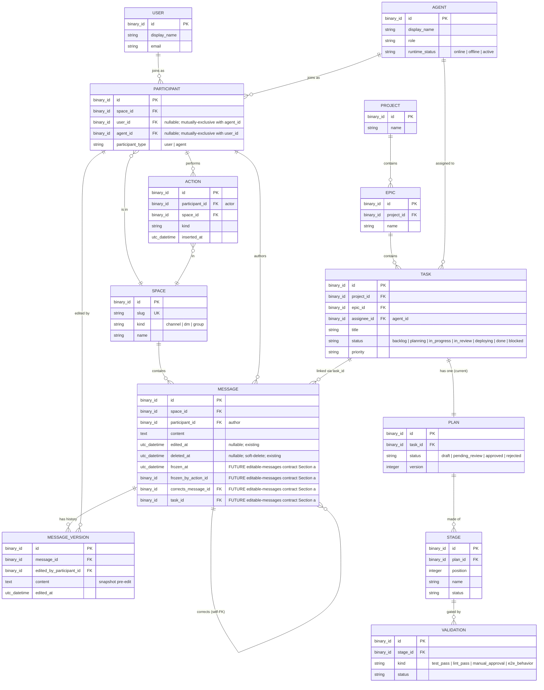

# Entity relationships — Burrow domain

**Visual reference for the design system.** This diagram pins the canonical entity vocabulary the design system speaks. It's the single picture that answers "when copy says `participant`, what data does that map to?" Cross-references `03-voice.md` for the user-facing terminology.

> **Scope:** the domain entities the audit-scoped surfaces (chat, tasks, activity, shell) render. NOT a full ERD of the platform — `Vault`, `Federation`, `Audit`, `Push`, `Execution`, `Context` all exist but aren't user-facing in scope.

## Voice mapping (cross-references `03-voice.md`)

| Diagram entity     | User-facing term           | Aliases avoided                       |
|--------------------|----------------------------|---------------------------------------|
| `USER`             | "person" / "you"            | ~~user~~ (in body copy)               |
| `AGENT`            | **`agent`**                 | ~~bot~~, ~~principal~~, ~~workspace~~, ~~runtime~~ |
| `PARTICIPANT`      | **`participant`**           | ~~member~~, ~~attendee~~              |
| `SPACE`            | **`space`** (with kinds: "channel" / "direct message") | ~~conversation~~, ~~room~~ |
| `MESSAGE`          | "message"                    | (no drift)                            |
| `MESSAGE_VERSION`  | "version" (in version history popover) | (n/a in copy outside that popover) |
| `TASK`             | **`task`**                  | ~~ticket~~, ~~item~~, ~~card~~        |
| `PLAN`             | "plan" (state-of-task)        | (kept; specific to role)              |
| `STAGE`            | "stage" (within a plan)       | (kept)                                |
| `VALIDATION`       | "review" (umbrella for review-blocking validations) / "check" (for automated test/lint) | ~~validation~~ in copy   |
| `ACTION`           | "agent activity" (in Activity surface) | ~~event~~, ~~log entry~~              |

## Notable invariants surfaced by the diagram

1. **`PARTICIPANT` is the bridge between humans and agents in spaces.** A user can be a participant in many spaces; an agent can be a participant in many spaces. The same human or agent gets a fresh `PARTICIPANT` row per space they join. This is why naming drift (`user` vs `participant`) confuses — they ARE different things, just adjacent.

2. **Four fields on `MESSAGE` are FUTURE — not present in `apps/platform/lib/platform/chat/message.ex` today.** Specifically `frozen_at`, `frozen_by_action_id`, `corrects_message_id`, and `task_id` are added by the editable-messages contract Section (a). Without these:
   - Policy 2's task-scoped freeze can't fire (needs `frozen_at` + `task_id`).
   - Agent corrections can't be threaded back to originals (needs `corrects_message_id`).
   The arrows `TASK ||--o{ MESSAGE` and `MESSAGE ||--o{ MESSAGE : "corrects (self-FK)"` represent these new linkages. Existing `MESSAGE` fields not shown in the simplified ERD: `thread_id`, `canvas_id`, `content_type`, `structured_content`, `metadata`, `log_only`, and the `author_*` snapshot fields.

3. **`TASK.assignee_id` is the current-phase derived field, not a plain `AGENT` FK.** The actual `apps/platform/lib/platform/tasks.ex` schema has both `assignee_id` (binary_id) and `phase_assignees` (map). `assignee_id` is computed from the current phase's assignment in `phase_assignees`; the source-of-truth is the map. The relationship arrow `AGENT ||--o{ TASK : "assigned to"` is correct at the conceptual level (an agent is assigned to a task at the current phase), but Phase 4 implementers should consult `phase_assignees` rather than treating `assignee_id` as a static FK.

4. **`TASK ||--|| PLAN`** is "current plan." The plan engine supports versioned plans (`PLAN.version`), so a task may have many plan rows historically; one is current. The diagram shows the current-plan-of-task relationship.

5. **`AGENT ||--o{ TASK : "assigned to"`** is what Policy 1 of the editable-messages contract uses to gate notification scope: "if `msg.task_id IS NOT NULL` AND that task's `assignee_id == agent_id`, the agent receives `{:message_updated, _, _}`." Per invariant #3, this practically means matching against the *current-phase* assignee derived from `phase_assignees`.

## What this diagram does NOT show

- **Cardinality on per-message reactions, pins, attachments, threads, canvases** — they exist but are out of audit scope.
- **OAuth credentials, vault entries, federation runtime adapters** — backend-internal, no user-facing surface in audit scope.
- **Realtime PubSub topics + subscription state** — not data; lives in process state.

---

This diagram is the design system's quick-reference card. Phase 4 may move it into `docs/architecture/` if it proves useful as a domain reference beyond the design system.
